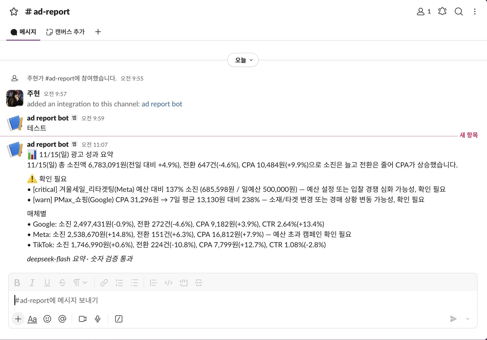

# Daily Ad Report Bot

광고 매체(Meta, Google, TikTok)의 전일 성과를 매일 08:00(KST)에 수집·집계하고, 이상 징후를 탐지하여 요약 리포트를 Slack으로 발송합니다.

수치는 모두 SQL로 계산하며, LLM(DeepSeek `deepseek-flash`)은 문장 작성만 담당합니다. LLM이 작성한 요약은 발송 전 수치 검증을 거칩니다.



## 1. 구성

```
Mock 매체 API → Adapter(정규화) → PostgreSQL(Supabase) → SQL 집계·이상 탐지
    → DeepSeek 요약 → 수치 검증 → Slack 발송(실패 시 이메일)
```

GitHub Actions가 매일 1회 실행하며, 상시 서버는 두지 않습니다.

| 매체 | 응답 형식 | Adapter 처리 |
|---|---|---|
| Meta | 수치가 문자열, 전환이 `actions[]` 내부에 위치 | `purchase` 액션을 전환으로 사용 |
| Google | 비용이 `cost_micros`, 노출 필드명이 `impr` | 1,000,000으로 나누고 필드명 통일 |
| TikTok | UTC 기준 시간별 데이터, USD | KST 일자로 재집계 후 원화 환산 |

## 2. 배포 설정

필요 항목: GitHub, [Supabase](https://supabase.com), Slack, [DeepSeek API 키](https://platform.deepseek.com/api_keys)(선택)

1. **Supabase**: 프로젝트 생성 후 Connect → Session pooler의 URI에서 `[YOUR-PASSWORD]`를 실제 비밀번호로 교체합니다. GitHub Actions는 IPv6 직접 연결을 지원하지 않으므로 pooler 주소를 사용해야 합니다. 테이블은 첫 실행 시 자동 생성됩니다.
2. **Slack**: [api.slack.com/apps](https://api.slack.com/apps)에서 앱 생성 → Incoming Webhooks 활성화 → 채널을 지정하여 Webhook URL을 발급합니다.
3. **GitHub Secrets**: Settings → Secrets and variables → Actions에 아래 값을 등록합니다.

| 이름 | 필수 | 설명 |
|---|---|---|
| `DATABASE_URL` | O | Supabase 접속 주소 |
| `SLACK_WEBHOOK_URL` | O | Slack Webhook URL |
| `DEEPSEEK_API_KEY` | - | 미등록 시 템플릿 리포트로 발송 |
| `SMTP_HOST` `SMTP_PORT` `SMTP_USER` `SMTP_PASSWORD` `EMAIL_TO` | - | Slack 실패 시 이메일 발송 |

4. **실행**: Actions → daily-ad-report → Run workflow로 즉시 실행할 수 있습니다. 첫 실행 시 최근 7일 데이터를 함께 적재합니다.

## 3. 로컬 실행

```bash
python3.11 -m venv .venv && source .venv/bin/activate
pip install -r requirements-dev.txt
cp .env.example .env
```

`DATABASE_URL`을 비워 두면 로컬 내장 PostgreSQL(`.pgdata/`)을 사용합니다.

```bash
uvicorn mock_api.app:app --port 8000      # 터미널 1: Mock API
python -m pipeline backfill --days 30     # 터미널 2: 30일 데이터 적재
python -m pipeline daily --dry-run        # 리포트 생성(발송 없음)
```

| 명령 | 설명 |
|---|---|
| `python -m pipeline init-db` | 테이블 생성 |
| `python -m pipeline backfill --days 30` | 최근 30일 데이터 적재 |
| `python -m pipeline daily` | 전일 리포트 생성 및 발송 |
| `python -m pipeline daily --date 2026-11-12` | 지정 일자 리포트 |
| `python -m pipeline daily --dry-run` | 발송 없이 출력 |
| `python -m pipeline daily --no-llm` | 템플릿 리포트 |
| `python -m mock_api.generator 14` | 최근 14일 이상 징후 주입 내역 조회 |

실행 결과는 `out/report_<날짜>.json`(LLM 입력)과 `out/message_<날짜>.txt`(발송 메시지)로 저장됩니다.

## 4. 설정 변경

임계값, 매체, 환율, LLM 모델은 `config.yaml`에서 변경합니다.

```yaml
alerts:
  ctr_drop:     { ratio: 0.70, severity: warn }      # 전일 CTR < 7일 평균 × 0.70
  overspend:    { ratio: 1.20, severity: critical }  # 전일 소진액 > 일예산 × 1.20
  cpa_spike:    { ratio: 1.50, severity: warn }      # 전일 CPA > 7일 평균 × 1.50
  missing_data: { severity: critical }               # 활성 캠페인의 전일 데이터 누락
```

- 매체 제외: `media.<매체>.enabled: false`
- 환율: `fx.USD_KRW`
- LLM: `llm.model`, `llm.base_url`, `llm.api_key_env` (OpenAI 호환 API 사용 가능)

LLM 비용은 1회 약 입력 3천·출력 5백 토큰 기준 월 $0.03 이하로 추정됩니다.

## 5. 장애 처리

| 상황 | 처리 |
|---|---|
| 일부 매체 수집 실패 | 해당 매체를 제외하고 발송, 메시지에 데이터 이슈 표기, 상태 `partial` |
| 요약 수치 불일치 | 1회 재생성 후에도 불일치 시 템플릿 리포트 발송 |
| API 키 없음 또는 LLM 오류 | 템플릿 리포트 발송 |
| Slack 발송 실패 | 이메일 발송(설정 시) |
| 전체 실패 | Slack 실패 알림, Actions 실패 처리 |
| 동일 일자 재실행 | upsert로 중복 없이 갱신 |

실행 이력은 `run_logs` 테이블에 기록됩니다.

```sql
SELECT report_date, status, detail->'steps'->'summary'->>'source' AS summary_by, finished_at
FROM run_logs ORDER BY finished_at DESC LIMIT 10;
```

매체 장애 재현: `MOCK_FAIL_MEDIA=tiktok uvicorn mock_api.app:app --port 8000`

## 6. 설계

- **계산과 서술 분리**: 합계, 변화율, CPA, 경보는 SQL(`pipeline/metrics.py`)에서 계산하고, LLM에는 표기가 완료된 문자열만 전달합니다.
- **수치 검증**: 요약문의 원·%·건 단위 수치를 추출하여 입력 JSON과 대조합니다. 만·억 단위 표기는 환산하여 비교하며, 경보 캠페인이 누락된 경우에도 실패로 처리합니다.
- **멱등성**: `fact_daily`는 `(report_date, campaign_id)` 기준 upsert, `alerts`는 일자 단위로 재작성합니다.
- **Adapter 패턴**: 매체 추가 시 `pipeline/adapters/`에 파일을 추가하고 `ADAPTERS`에 등록합니다. 실제 API 연동 시 `fetch_*` 메서드만 교체합니다.
- **시간대**: TikTok은 UTC 시간별 데이터를 KST 일자(UTC 전일 15:00~당일 14:59)로 재집계합니다.
- **보안**: 비밀값은 GitHub Secrets와 `.env`에서만 관리합니다. 전 테이블에 RLS를 적용하여 Supabase 공개 키로는 접근할 수 없으며, LLM에는 집계 수치만 전달합니다.

Mock 데이터에는 다음 이상 징후가 주기적으로 주입됩니다. 동일 일자는 항상 동일한 값을 반환합니다.

| 규칙 | 캠페인 | 주기 |
|---|---|---|
| `ctr_drop` | 신규설치_UA (TikTok) | 4일 |
| `overspend` | 겨울세일_리타겟팅 (Meta) | 3일 |
| `cpa_spike` | PMax_쇼핑 (Google) | 5일 |
| `missing_data` | 유튜브_리마케팅 (Google) | 6일 |

## 7. 테스트

```bash
pytest -q
```

Adapter 정규화, 검증기, 재실행 시 중복 여부, 이상 징후 탐지 정확도(21일간 주입분 전체 탐지, 오탐 0건), LLM 재생성 및 대체 동작을 검증합니다.

## 8. 디렉터리 구조

```
mock_api/            Mock 매체 API, 데이터 생성기
pipeline/
  adapters/          매체별 Adapter
  collector.py       수집
  loader.py          적재
  metrics.py         집계, 이상 탐지
  summarizer.py      요약, 템플릿 리포트
  validator.py       수치 검증
  notifier.py        발송
  __main__.py        실행 명령
sql/schema.sql       스키마, RLS
config.yaml          설정
.github/workflows/   daily.yml, test.yml
```

## 9. 향후 과제

- 실제 매체 API 연동
- Slack 질의응답 기능(캠페인별 추이 조회)
- 알림 피드백을 반영한 임계값 조정
- 매체 청구액과 내부 집계의 정산 대사
